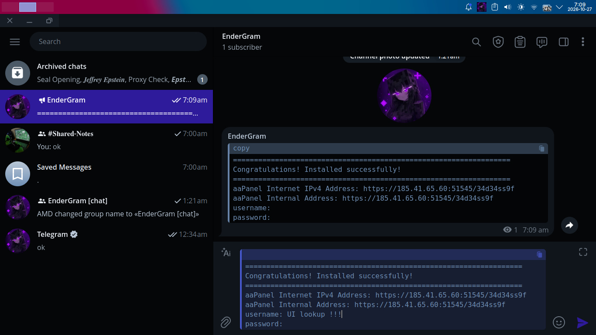
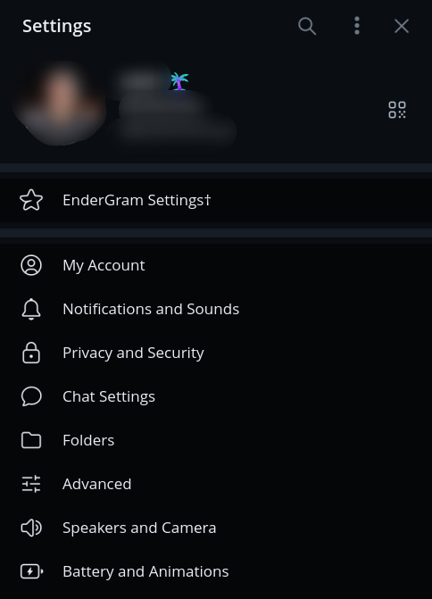
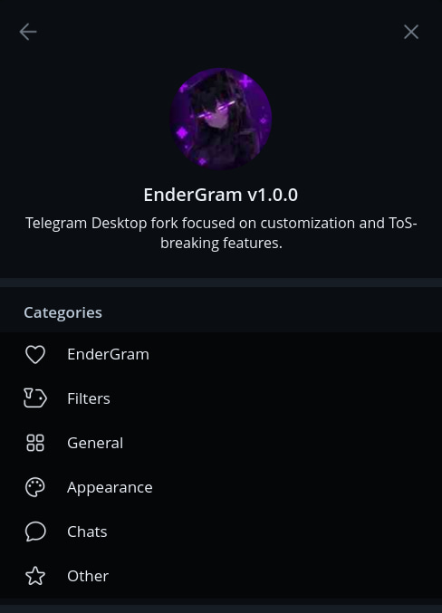

# EnderGram

A fast, low-memory Telegram-compatible desktop client for Linux, with a
distinctive theme, a native launcher and a privacy-first feature set.

[Website](https://endergram.win) · [Downloads](https://github.com/SujayPro/EnderDesk/releases) · [Channel](https://t.me/EnderGramNews) · [Chat](https://t.me/EnderGramChat)

## Features

- Full Telegram messaging: chats, groups, channels, calls, media, stickers
- **Ghost mode** — control read receipts and typing visibility
- **Deleted message history** — keep messages even after they are removed
- **Message filters** — regex rules, per-chat filters and auto-actions
- **Built-in translator** — translate messages without leaving the chat
- **Streamer mode** — hide sensitive content while screen sharing
- **Local premium** — unlock client-side premium UI features
- **Deep customization** — avatar corners, bubble radius, custom app icons,
  message tails, reply styling, and more
- **Low-memory mode** — measured ~248 MB RSS on a default launch
- **Frameless KDE window** — clean, native-looking Plasma integration
- **EnderGram themes** — Noir (gunmetal/indigo) and Frost (cool white) with a
  custom night-scene chat wallpaper

## Preview

<p align="center">
  
</p>

<p align="center">
  
  &nbsp;&nbsp;&nbsp;&nbsp;
  
</p>

## Download

| Build | File |
|---|---|
| Debian / Ubuntu / Kubuntu / Mint | `endergram_1.0.0-10_amd64.deb` |
| Portable (any Linux x86_64) | `EnderGram-1.0.0-x86_64.AppImage` |

Get the latest from [endergram.win](https://endergram.win) or the
[releases page](https://github.com/SujayPro/EnderDesk/releases).

## Install

### Debian package

```bash
sudo apt install ./endergram_1.0.0-10_amd64.deb
```

Or, for a local unsigned package:

```bash
sudo dpkg -i endergram_1.0.0-10_amd64.deb
sudo apt-get -f install
```

### AppImage

```bash
chmod +x EnderGram-1.0.0-x86_64.AppImage
./EnderGram-1.0.0-x86_64.AppImage
```

## Requirements

- Linux x86_64, KDE Plasma (Wayland or X11) recommended
- Debian 11+, Ubuntu 22.04+, Kubuntu 22.04+, Linux Mint 21+ for the `.deb`
- Any modern glibc distribution for the AppImage

## Low-memory mode

The launcher uses a lean profile by default: XWayland rendering, OpenGL/RHI
disabled, and aggressive heap trimming.

| Mode | RSS | PSS |
|---|---:|---:|
| Default (low memory) | **248 MB** | **223 MB** |
| `--gpu` | 322 MB | 243 MB |

The first launch may sit around 265 MB while the local cache is generated; a
normal second launch settles near 248 MB. Memory grows with open chats and
media playback.

### GPU acceleration

```bash
endergram --gpu
```

The KDE menu also exposes **Launch EnderGram with GPU acceleration**.

## Themes

- **EnderGram Noir** — gunmetal dark with indigo accents
- **EnderGram Frost** — cool white light theme with the EnderGram wallpaper

Both ship inside the app and are also installed as
`/usr/share/endergram/themes/*.tdesktop-theme`.

## Frameless window

EnderGram is frameless on KDE by default: the launcher manages a scoped
`[endergram]` rule in `~/.config/kwinrulesrc` (backup:
`kwinrulesrc.endergram.bak`). Other applications keep their decorations.

- Close: `Alt+F4`, taskbar button, or tray → Quit
- Minimize: taskbar, `Meta+H`, or tray
- Move: `Alt+Left-drag`; resize: `Alt+Right-drag`
- Native titlebar for one launch: `endergram --titlebar`

## Launcher

`/usr/bin/endergram` is a small shell launcher. It selects the graphics
profile, applies the KWin rule and starts the engine. The engine itself is the
Telegram-compatible desktop codebase, not a reimplementation.

## Build from source

```bash
git clone https://github.com/SujayPro/EnderDesk
cd EnderDesk/upstream
git submodule update --init --recursive
./configure.sh
```

See `upstream/docs/building-linux.md` for the full toolchain guide. The four
submodules listed in `upstream/.gitmodules` (`codegen`, `lib_ui`, `lib_tl`,
`lib_icu`) must exist in your account, or be pointed at their upstream
repositories.

## Verify

```
4d59e18ef221d8a274f3e04d38f206d1f6e84c71a96fdd709187bc883c6cdf2a  endergram_1.0.0-10_amd64.deb
e22760fb1eb9299f2be534f81249c372b2ee3cdc2f898fb208c0cf2f6da7b6a1  EnderGram-1.0.0-x86_64.AppImage
```

## License

GPL-3.0 with the OpenSSL exception, matching the desktop codebase it is built
on. See `LICENSE` and `packaging/usr/share/doc/endergram/` for details.

EnderGram is an independent community project and is not affiliated with
Telegram Messenger LLP. It is a fork of
[AyuGram Desktop](https://github.com/AyuGram/AyuGramDesktop), which builds on
[Telegram Desktop](https://github.com/telegramdesktop/tdesktop) — thanks to
both projects and their contributors.
