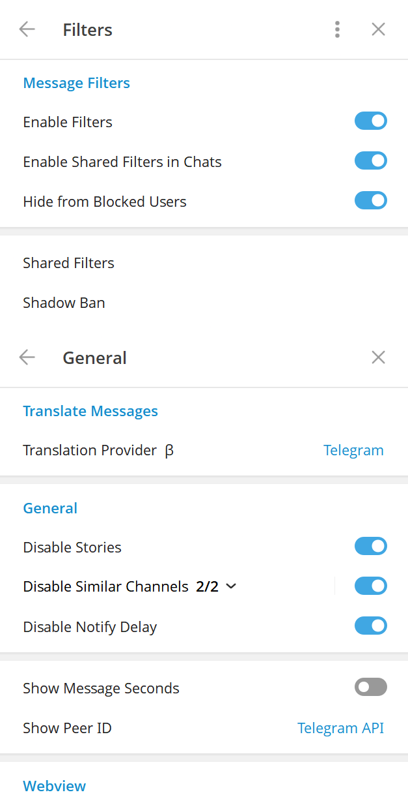
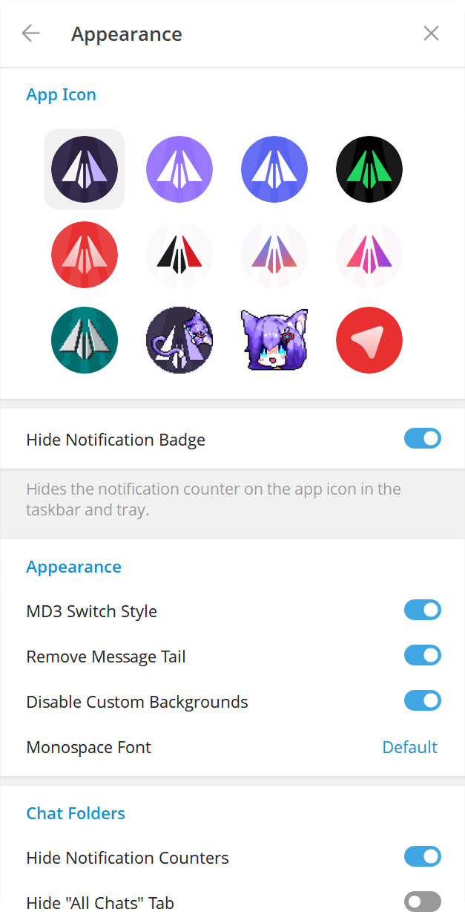
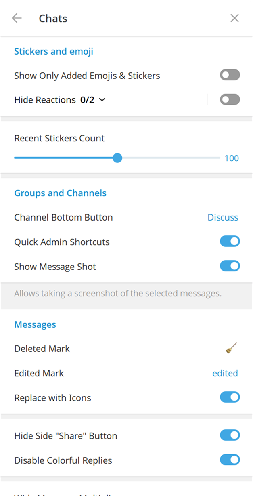

# EnderGram

 

[ English  |   [Русский](README-RU.md) ]

## Features

- Full ghost mode (flexible)
- Messages history
- Anti-recall
- Font customization
- Streamer mode
- Local Telegram Premium
- Translator
- Media preview & quick reaction on force click (macOS)
- Enhanced appearance

And many more. Check out our [Documentation](https://github.com/SujayPro/EnderGram/desktop/).

<h3>
  <details>
    <summary>Preview</summary>
    <table>
      <tr>
        <td></td>
        <td></td>
        <td></td>
      </tr>
      <tr>
        <td></td>
        <td></td>
      </tr>
    </table>
  </details>
</h3>

## Downloads

### Windows

#### Official

You can download prebuilt Windows binary from [Releases tab](https://github.com/SujayPro/EnderGram/releases) or from
the [Telegram channel](https://t.me/EnderGramNews).

#### Winget

```bash
winget install RadolynLabs.EnderGramDesktop
```

#### Scoop

```bash
scoop bucket add extras
scoop install endergram
```

#### Self-built

Follow [official guide](https://github.com/SujayPro/EnderGram/blob/dev/docs/building-win-x64.md) if you want to
build by yourself.

### macOS

#### Official

You can download prebuilt macOS package from [Releases tab](https://github.com/SujayPro/EnderGram/releases).

#### Homebrew

```bash
brew install --cask endergram
```

### Arch Linux

#### From source (recommended)

Install `endergram-desktop` from [AUR](https://aur.archlinux.org/packages/endergram-desktop).

#### Prebuilt binaries

Install `endergram-desktop-bin` from [AUR](https://aur.archlinux.org/packages/endergram-desktop-bin).

Note: these binaries aren't officially maintained by us.

### NixOS

#### Flake (recommended)

Install `endergram-desktop` from [ndfined-crp/endergram-desktop](https://github.com/ndfined-crp/endergram-desktop)

#### Nixpkgs

Install `endergram-desktop` from [nixpkgs](https://search.nixos.org/packages?channel=unstable&show=endergram-desktop)

### ALT Linux

[Sisyphus](https://packages.altlinux.org/en/sisyphus/srpms/endergram-desktop/)

### Gentoo Linux

See [this repository](https://codeberg.org/OverLessArtem/endergram-ebuild-gentoo) for installation manual.

### Void Linux
See [this repository](https://codeberg.org/OverLessArtem/endergram-template-void) for installation manual.

### EPM

`epm play endergram`

### Fedora

From [RPM Fusion](https://admin.rpmfusion.org/pkgdb/package/free/endergram-desktop/) repository.

```bash
dnf install endergram-desktop
```

### Any other Linux distro

Flatpak: https://github.com/0FL01/EnderGramDesktop-flatpak

Or follow the [official guide](https://github.com/SujayPro/EnderGram/blob/dev/docs/building-linux.md).

## Donation

Enjoy using **EnderGram**? Consider sending us a tip!

[Here's available methods.](https://github.com/SujayPro/EnderGram/donate/)

## Credits

### Telegram clients

- [Telegram Desktop](https://github.com/telegramdesktop/tdesktop)
- [Kotatogram](https://github.com/kotatogram/kotatogram-desktop)
- [64Gram](https://github.com/TDesktop-x64/tdesktop)
- [Forkgram](https://github.com/forkgram/tdesktop)

### Libraries used

- [JSON for Modern C++](https://github.com/nlohmann/json)
- [SQLite](https://github.com/sqlite/sqlite)
- [sqlite_orm](https://github.com/fnc12/sqlite_orm)
- [androidx sources](https://github.com/androidx/androidx)

### Icons

- [Solar Icon Set](https://www.figma.com/community/file/1166831539721848736)

### Bots

- [TelegramDB](https://t.me/tgdatabase) for username lookup by ID (until closing free inline mode at 2 April 2026)
